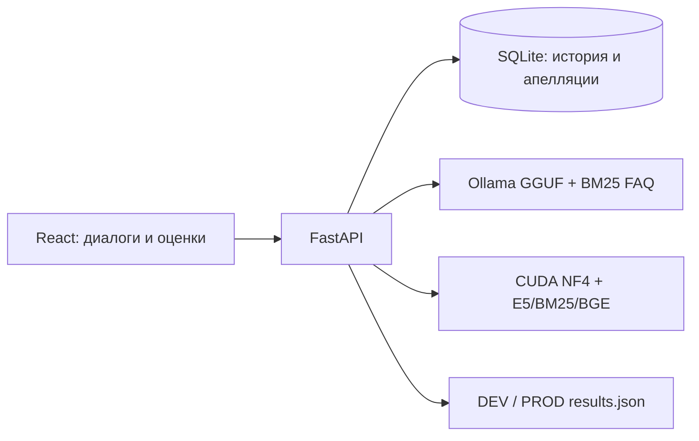

# Freedom CQA


**Диалог → обоснованная оценка → проверка → апелляция → результат.**

[Интеграция модели](MODEL_INTEGRATION.md) · [Пример импорта](docs/presentation-practice.json)

Локальное приложение для анализа качества разговоров: React 18, FastAPI, SQLite. Интерфейс в символике Freedom, без регистрации. Оригинальные транскрипты RU/KZ/EN и номера реплик сохраняются.

## Архитектура



## Запуск

В терминале VS Code из этой папки:

```bash
./start.command
```

Сайт: http://127.0.0.1:8000/ · API: http://127.0.0.1:8000/docs.
Остановка: Ctrl+C. Если порт уже занят, используйте запущенный экземпляр или остановите его перед повторным запуском. Терминал сервера нужно оставить работающим.

При первом запуске нужны Python 3.10+ и интернет для установки `requirements.txt`. В текущей папке окружение уже установлено. Для обычного запуска Node.js не нужен: готовый `frontend/app.js` включён, React и шрифт Manrope хранятся локально.

## Модель на Mac

```bash
./start_model_mac431.command
```

Актуальная интеграция CQA 43.1: общий runtime, Qwen GGUF через Ollama/Metal на GPU, E5 и BGE на CPU, поиск E5/BM25/BGE. Первый запуск загружает модели поиска; требуется Python 3.12. В «Модель и данные»: local, `http://127.0.0.1:9001/evaluate`, фактическое имя с CQA 43.1, timeout 900. Упрощённая прежняя BM25-ветка на 9000 доступна через `start_model_mac.command`.

GGUF и NF4 используют разные генераторы и квантизацию: одинаковый runtime не гарантирует одинаковые оценки. Фактическое использование GPU смотрите командой `work/runtime/ollama/ollama ps`.

## Приватный репозиторий

Исходники: [Daulet-coder/freedom-cqa-XINGXING](https://github.com/Daulet-coder/freedom-cqa-XINGXING). HTML, JSX, CSS, готовый JS, API, helpers, model runtime, тесты, FAQ и результаты включены. Исключены веса, окружения, рабочая SQLite, аудиоссылки с секретными параметрами и локальная авторизация.

`data/dev_dataset.public.json` содержит те же 65 исходных транскриптов с `audio_url: null`. Локально при наличии используется оригинальный `data/dev_dataset.json`. Можно задать `CQA_DATASET_PATH` до первого запуска; секретные ссылки не коммитить. На чистой установке для просмотра результатов импортируйте `model_service/results/results.json` через интерфейс (официальный чек-лист уже установлен).

## Рабочие сценарии

- **Обзор**: состав основных наборов, последние оценки, охват, переходы к задачам. CUSTOM и DEMO считаются отдельно.
- **Диалоги**: фильтр набора DEV/PROD/CUSTOM/DEMO, языка, статуса и грубых ошибок; поиск по ID и тексту; импорт JSON; импорт оценок модели.
- **Карточка**: аудиобар, таймкоды, исходная расшифровка, поиск (Enter / Shift+Enter), восемь критериев, обоснования и доказательства. Нажатие «Реплика» прокручивает страницу к расшифровке, выделяет сообщение и переводит аудио на таймкод.
- **Оценка**: отдельный диалог или текущая отфильтрованная выборка отправляется в сохраняемую очередь. Видны прогресс, текущий ID и ошибки. Отмена останавливает оставшиеся запросы после окончания текущего; уже полученные результаты сохраняются. При перезапуске очередь помечается прерванной, а не якобы успешно завершённой.
- **Чек-лист**: правила, веса, типы ответа, числовые шкалы, N/A, новые критерии и версии. «Официальный чек-лист» создаёт новую версию с исходными критериями. Сохранение конфигурации не меняет старые результаты: требуется новая оценка. Во время обработки настройки защищены от изменения.
- **Апелляция**: выбрать критерий, написать комментарий, отправить, затем в разделе «Апелляции» подтвердить или изменить значение с причиной. Итог пересчитывается; оригинальные значения и решения сохраняются. Незакрытая апелляция блокирует переоценку соответствующего диалога.
- **История**: отдельная кнопка в карточке показывает все сохранённые версии. Переоценка больше не удаляет предыдущую оценку и её пересмотры.
- **Аналитика**: сводка сохранённых результатов. Средний балл разговоров не является точностью модели.
- **Модель и данные**: режим, URL сервиса, фактическое название модели, тайм-аут, название команды и проверка подключения.

## Подключение настоящей модели

Откройте **«Модель и данные»**:

1. Выберите режим local / external_api / hybrid.
2. Укажите URL CQA-сервиса, например `http://127.0.0.1:9000/evaluate`.
3. Укажите фактическое название модели и сохраните настройки.
4. Нажмите «Проверить подключение».
5. Оцените новый короткий диалог: только успешный inference подтверждает работу всей цепочки.

URL должен принимать `{conversation, checklist}` и возвращать `{criteria, metadata?}` по контракту в `MODEL_INTEGRATION.md`. Произвольный API LLM требует адаптера. Проверка доступности использует соседний маршрут `/health`.

Пока настройки через UI не сохранялись, используются переменные окружения:

```bash
export CQA_MODEL_URL=http://127.0.0.1:9000/evaluate
export CQA_MODEL_NAME='Qwen3.5-9B NF4 + RAG (base, not fine-tuned)'
export CQA_MODEL_TIMEOUT=900
./start.command
```

После сохранения через интерфейс настройки SQLite имеют приоритет над переменными окружения. Для смены режима используйте интерфейс. Ошибка сервиса не подменяется результатом демо-правил. Старые демо-оценки не становятся модельными после переключения режима.

Готовый GPU-сервис находится в `model_service/`; загрузка весов и inference требуют подходящего CUDA-хоста. Локально сохранены и проверены веса `models/qwen3.5-9b-nf4`: 10 файлов, четыре safetensors shards, 7 660 361 799 байт. Большие веса исключены из Git; манифест включён. Код сервиса не является доказательством, что модель уже запущена. Архитектура базовой модели и RAG описана в `MODEL_INTEGRATION.md`; дообучение там не заявлено. Точность CQA относительно независимого Ground Truth не измерена.

## Наборы и импорт

- **DEV** — исходные 65 ID предоставленного набора; зарезервирован для этих записей.
- **PROD** — контрольные транскрипты организаторов; официальный экспорт требует ровно 10 записей.
- **CUSTOM** — репетиции и собственные тесты.
- **DEMO** — два явно помеченных примера интерфейса.

«Загрузить диалоги» принимает ответ организаторов с `data.records`, массив записей или один разговор. Выберите CUSTOM либо PROD в форме. Существующие ID не перезаписываются. Для повторного собственного теста используйте новый ID; официальные ID не меняйте. Проверяются роли, язык, канал и метки времени MM:SS / ISO 8601 с часовым поясом.

«Импорт оценок» принимает `schema_version: "1.0"`, `model: {mode,name}`, `results`. Транскрипты с соответствующими ID должны уже присутствовать. Весь файл проверяется до записи: уникальность ID, допустимые значения, полные критерии, исходные номера доказательств и совпадение итогов с расчётом. Можно передать `checklist`, но он должен совпадать с текущим. Без него применяются текущие правила — выберите соответствующую версию до импорта. Источник отмечается как импортированный, происхождение модели заявлено в файле, экспертное качество не подтверждается. Импорт позволяет просматривать результаты с Kaggle без GPU на ноутбуке, но не заменяет живую обработку новых разговоров.

## Экспорт для организаторов

В «Экспорте» выберите DEV или PROD. Приложение проверяет:

- 65 / 10 разговоров соответственно, без подмешивания CUSTOM и DEMO;
- наличие результатов по каждому ID;
- отсутствие демонстрационных оценок и незавершённых апелляций;
- полное совпадение конфигурации критериев с текущей (метка версии Kaggle может отличаться);
- официальный набор восьми ID, весов, типов, шкал и разрешений N/A.

Строгая выгрузка имеет только поля `schema_version`, `team_name`, `model`, `results`. Имя и режим модели берутся из оценок, а не из текущего переключателя; при нескольких режимах используется hybrid. Проверка структуры не доказывает семантическое соответствие правил и точность AI. Ошибки модели сохраняются в официальном формате `status=error`, `criteria=[]`, `score=null`, `error` и отдельно показываются в отчёте.

«Скачать для сдачи» отдаёт `results.json`. «Сохранить» записывает локально:

```text
results/dev/results.json
results/prod/results.json
```

При перезаписи предыдущий файл сохраняется как `results.backup-*.json`. Commit и push выполняются отдельно; приложение не публикует репозиторий. Пока проверка не пройдена, успешные итоговые файлы не создаются. Черновики можно скачивать отдельно, они помечены и не предназначены для сдачи.

## Расчёт и ограничения

Бинарные критерии дают полный вес / ноль; числовые — долю веса. N/A разрешён только соответствующим критериям и исключается из применимого веса. Итог нормализуется к 100, округляется до двух знаков. Если применимого веса нет, итог не рассчитывается. Флаг грубого нарушения не обнуляет балл.

Демо-правила нужны для репетиции интерфейса: они используют ограниченные маркеры, условные значения консультации/ведения и временное исключение идентификации. Они не понимают произвольный новый текст критерия. Поддержка RU/KZ/EN в данных не подтверждает языковую точность модели.

Аудиоссылки DEV разрешаются из страниц-плееров в прямой источник. При недоступности записи транскрипт остаётся доступен. Локальное аудио не загружается на сервер и после обновления страницы прикрепляется заново. Без декодированного файла показана схема активности по таймкодам, а не амплитуда записи. Прикрепление аудио само по себе не запускает ASR или оценку интонации.

Локальный сервер слушает 127.0.0.1. Авторизация не нужна для демонстрации; роли оператора и проверяющего представлены отдельными действиями. Это не публичное промышленное размещение.

## Разработка и проверки

```bash
node build.cjs
.venv/bin/python -m unittest discover -s tests -v
```

Node в текущем окружении: `/Users/daulet/.cache/codex-runtimes/codex-primary-runtime/dependencies/node/bin/node`.

Основные файлы: `frontend/app.jsx` — существующий интерфейс; `frontend/workspace.jsx` — подключение, очередь, экспорт и история; `backend/main.py` — API/хранение; `backend/workspace.py` — валидация выгрузки; `backend/scoring.py` — расчёт/провайдеры.

Проверки покрывают HTTP-контракт, очередь и отмену, импорт, экспорт, историю, апелляции, N/A и ошибки. Синтетический HTTP-сервис в тестах явно называется contract fixture и не доказывает качество настоящей модели. Проверки используют отдельные временные SQLite и папки результатов, пользовательские данные не меняют.

Для переноса данных сохраните `data/cqa.sqlite3` при остановленном сервере. `CQA_DB_PATH` и `CQA_RESULTS_PATH` позволяют использовать отдельные хранилища. Основная SQLite не входит в Git. Веса не следует публиковать вместе с runtime без отдельной проверки лицензии и размера.

## Полный CQA 43.1 на Mac через Ollama

Запуск: `./start_model_mac431.command` (Python 3.12; отдельное `.venv-model-mac`, зависимости зафиксированы в `model_service/requirements-mac431-lock.txt`). Первый запуск загружает E5 и BGE. Сервис: `http://127.0.0.1:9001/evaluate`. В «Модель и данные» выбрать local и сохранить этот URL и фактическое имя модели.

Общий `cqa_runtime.py` 43.1 выполняет извлечение фактов, отдельную эмпатию, проверки повторных вопросов и E5/BM25/BGE RAG. Заменён только генератор: вместо CUDA NF4 используется Qwen GGUF через Ollama/Metal. E5 и BGE работают на CPU. Предсказания не гарантированно совпадают с NF4. Прежний BM25-адаптер на 9000 сохранён как отдельная упрощённая ветка.
